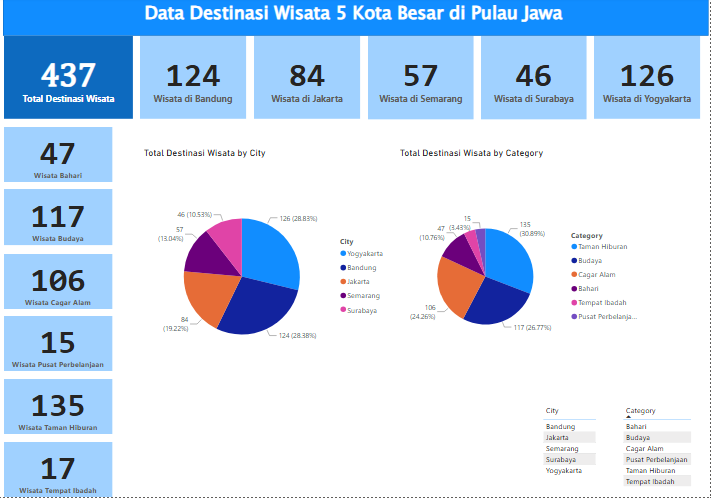

# 📊 Dashboard Data Destinasi Wisata 5 Kota Besar di Pulau Jawa

Dashboard interaktif **Power BI** yang menampilkan sebaran destinasi wisata di lima kota besar di Pulau Jawa (Jakarta, Bandung, Yogyakarta, Semarang, dan Surabaya). Project ini dibuat sebagai tugas **UAS** sekaligus portofolio analisis & visualisasi data.

## 📝 Deskripsi

Dashboard ini merangkum jumlah destinasi wisata berdasarkan **kota** dan **kategori wisata**, sehingga pengguna dapat dengan cepat melihat kota mana yang paling banyak memiliki destinasi dan kategori wisata apa yang paling dominan.

**Fitur utama:**
- **Kartu ringkasan (KPI)** jumlah wisata per kota: Jakarta, Bandung, Yogyakarta, Semarang, Surabaya.
- **Kartu ringkasan** jumlah wisata per kategori: Budaya, Bahari, Cagar Alam, Taman Hiburan, Pusat Perbelanjaan, Tempat Ibadah.
- **Total Destinasi Wisata** secara keseluruhan.
- **Pie chart** proporsi destinasi wisata per kota dan per kategori.
- **Tabel** daftar kota dan kategori yang dapat dipakai sebagai filter interaktif.
- Perhitungan menggunakan **DAX measure**.

## 🗂️ Dataset

Model data terdiri dari 4 tabel yang saling berelasi:

| Tabel | Keterangan |
|-------|------------|
| `tourism_with_id` | Data destinasi wisata (nama, kota, kategori, dll.) |
| `package_tourism` | Tabel measure/ringkasan jumlah wisata |
| `tourism_rating` | Data rating wisata dari pengguna |
| `user` | Data pengguna |

> Sumber data: Indonesia Tourism Destination dataset (Kaggle).

## 🖼️ Tampilan Dashboard



<!-- Opsional: tambahkan screenshot lain, mis. model data
 -->

## 🛠️ Tools yang Digunakan

- **Microsoft Power BI Desktop**: pembuatan dashboard & visualisasi
- **Power Query**: pembersihan dan transformasi data
- **DAX**: pembuatan measure (jumlah wisata per kota/kategori)
- **Data Modeling**: relasi antar tabel (star/snowflake schema)

## ▶️ Cara Menjalankan

1. Clone repository ini:
   ```bash
   git clone https://github.com/aris-maker/dashboard-wisata-jawa-powerbi.git
   ```
2. Buka file `Dashboard-Wisata-Jawa.pbix` menggunakan **Power BI Desktop** (gratis di Microsoft Store).
3. Jelajahi dashboard dan klik elemen visual untuk memfilter data.

## 👤 Author

**NAMA ANDA**
- GitHub: (https://github.com/aris-maker)
- LinkedIn: (https://linkedin.com/in/username)
